

**English** | [Português](README.pt-BR.md)

# Flow Ecosystem — Intelligent Systems

**One multi-tenant cloud platform that runs the daily operations of small and mid-sized businesses in Brazil: restaurants, beauty salons and retail stores.**

> [!NOTE]
> This is a curated technical showcase: product overview, architecture decisions, representative code excerpts and screenshots. The full source code is private because it serves live merchants. No end-customer data appears in this repository.

## Executive Summary

Flow Ecosystem is a software-as-a-service platform that replaces paper, spreadsheets and disconnected point solutions with a single system for orders, payments, inventory, scheduling and financial management. It ships as three products on one shared core: **BarFlow** for food service, **BeautyFlow** for salons and barbershops, and **FlowPDV** for retail. The platform is in production with paying merchants in Northeast Brazil, built and operated by a single founder with an engineering process designed for reliability: isolated tenants, an extensive automated test suite and a documented rollback plan for every release.

## The Problem

- Most small and mid-sized businesses in Brazil still run on paper order pads, spreadsheets and WhatsApp messages, or on several tools that do not talk to each other.
- Owners cannot see margins, cost of goods or break-even point until it is too late to act.
- Brazilian tax compliance is complex: electronic invoices (NFC-e and NF-e) are issued per sale and validated by each state's tax authority, with rules that vary by state.
- Off-the-shelf systems are usually built for one segment, priced for larger companies, or require on-premise installation.

## The Platform

| Product | Segment | Key capabilities | Status | Reference price* |
|---|---|---|---|---|
| **[BarFlow](docs/barflow.md)** | Bars, restaurants, cafés, bakeries | Digital menu with table QR codes, waiter app, kitchen display (KDS), cash register, recipe-based inventory, management dashboard (P&L, COGS, ABC analysis) | Live | R$ 49.90–139.90/mo (approx. US$ 9–26) |
| **[BeautyFlow](docs/beautyflow.md)** | Beauty salons, barbershops | Online self-booking with conflict-free scheduling, daily agenda, salon financials | Live | R$ 59.90/mo (approx. US$ 11) |
| **[FlowPDV](docs/flowpdv.md)** | Retail, phone and accessories stores | Full-screen point of sale, barcode and product variants, weighted-average-cost inventory, 12 reports, management dashboard, online storefront | Live; e-invoicing in certification | R$ 99.90/mo (approx. US$ 19) |

\* List prices defined in the codebase; USD at approx. R$ 5.40 per US$.

Every product runs on its own domain and brand while sharing authentication, permissions, the reporting and analytics engine, printing, push notifications and infrastructure.

## Product Highlights

Public pages are from **live merchants** and are shown with the owner's authorization (store name, logo, menu and public prices only; phone numbers, addresses and personal photos are blurred). Back-office screens require a login and were captured from demo stores on a local server with **demo data**; no real merchant appears in them.

### BarFlow — food service

| Digital menu, live merchant (Hikaya Sushi Bar) | Kitchen display (demo data) | Management dashboard with P&L (demo data) |
|---|---|---|
| 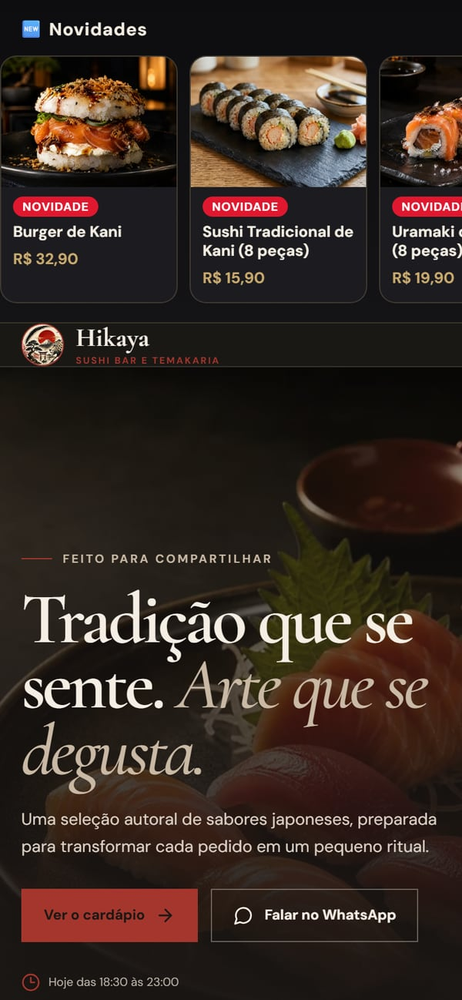 | 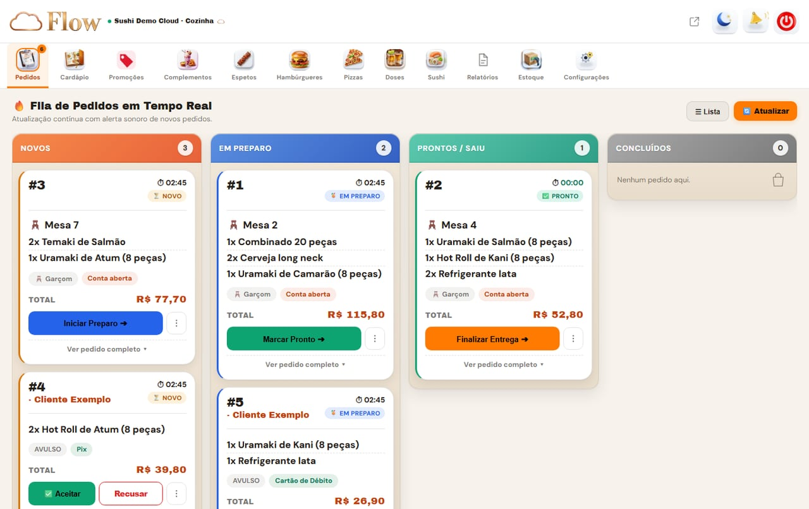 | 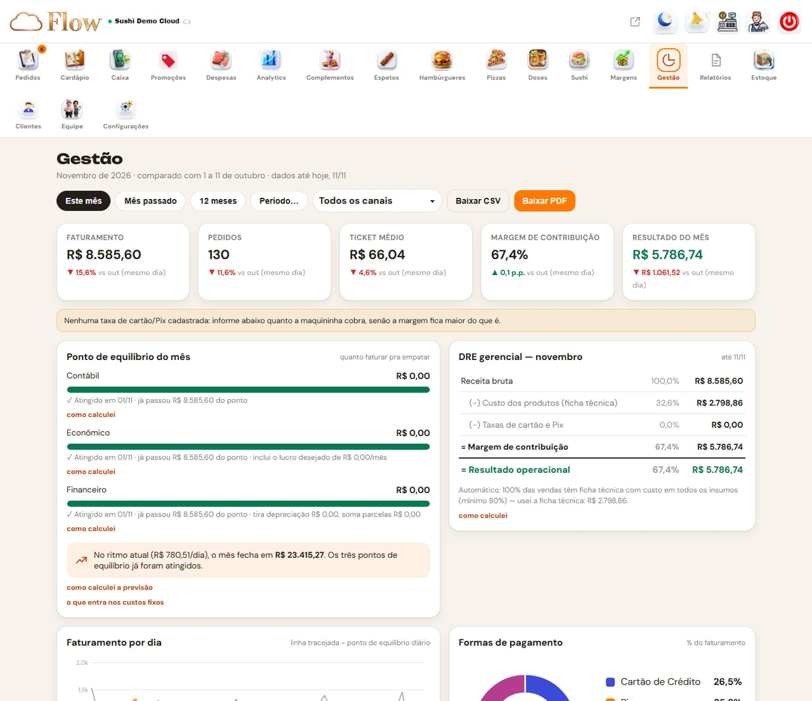 |

| Waiter app, table map (demo data) | Cash register (demo data) | Recipe-based inventory (demo data) |
|---|---|---|
| 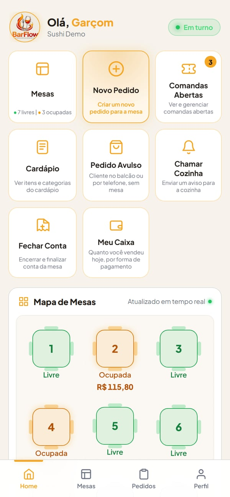 | 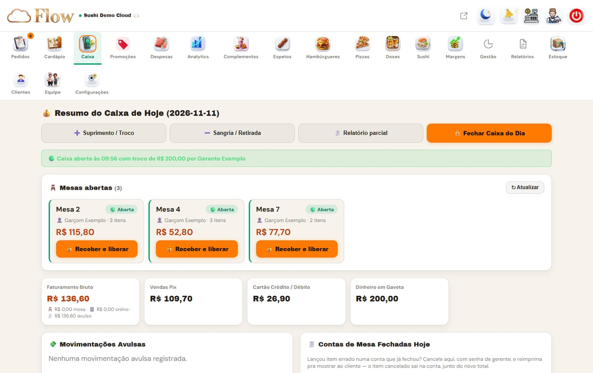 | 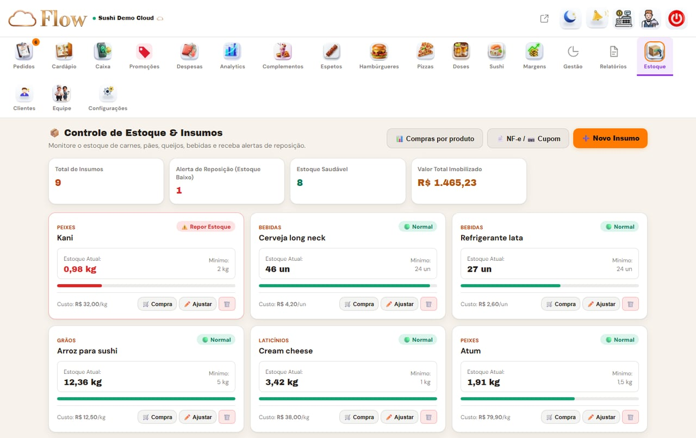 |

### BeautyFlow — salons and barbershops

| Online booking, live salon | Time-slot selection, live barbershop | Daily agenda (demo data) |
|---|---|---|
|  | 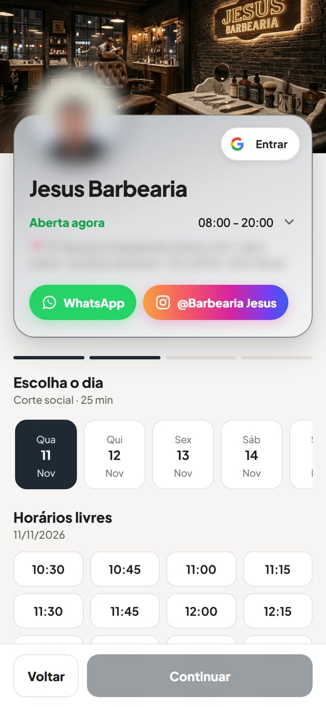 | 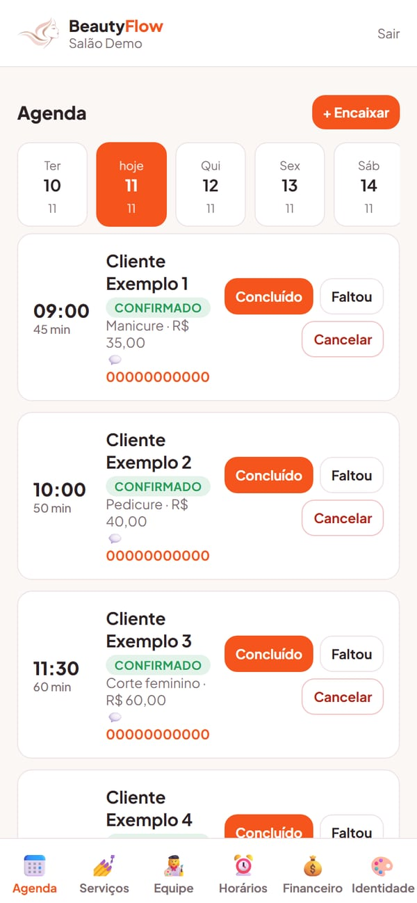 |

### FlowPDV — retail

| Online storefront, live merchant (Emporium do Confeiteiro) | Online storefront, live merchant (Limocell) | Point of sale (demo data) |
|---|---|---|
| 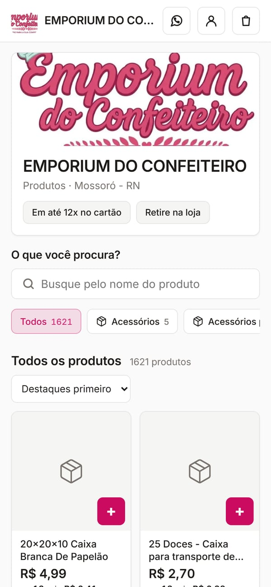 | 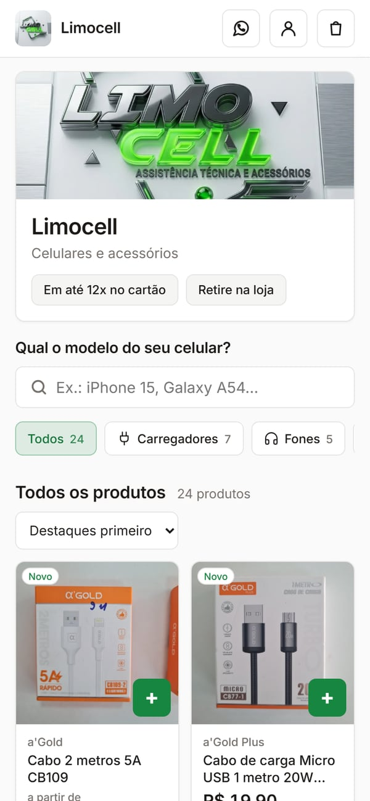 | 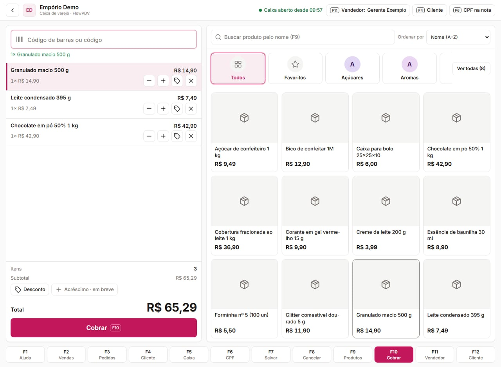 |

Full galleries: [BarFlow](docs/barflow.md#telas) · [BeautyFlow](docs/beautyflow.md#telas) · [FlowPDV](docs/flowpdv.md#telas)

## Traction

- In production since August 2026, with paying merchants in Northeast Brazil across food service, beauty and retail.
- More than 260 production releases, each with a written record of date, revision and rollback plan.
- The retail product is being adopted by a store migrating from an established point-of-sale vendor, including import of its sales history.

## Technology & Engineering Excellence

| Area | Practice |
|---|---|
| **Multi-tenant isolation** | Single database with a tenant key on every table and every query; adversarial tests log in as tenant A and attempt to read or modify tenant B ([excerpt](excerpts/multiTenantIsolation.test.js)) |
| **Automated testing** | ~4,350 test cases in 728 files, run against a real disposable PostgreSQL database (no database mocks); UI tests mount the actual pages |
| **Database migrations** | 268 idempotent SQL migrations applied automatically on every boot, so the previous revision can always run on the same database |
| **Release discipline** | 260+ production deploys, each with a documented rollback to the prior revision |
| **Automated audit** | A pre-commit hook runs a static checker on every commit and blocks anything that could leak data between tenants, miscalculate money or take operations down |
| **Data integrity** | Read-only invariants verify accumulated state (for example, a check total equals the sum of its lines) ([excerpt](excerpts/invariantesConta.js)) |
| **Concurrency** | Row-level locks per tenant serialize sensitive operations (scheduling, cash register, tables) without blocking other tenants ([excerpt](excerpts/agendamentoSemConflito.js)) |
| **Infrastructure** | Google Cloud Run, Cloud SQL (PostgreSQL), Cloud Storage, Secret Manager; four production dependencies |

Architecture details: [docs/arquitetura.md](docs/arquitetura.md) (Portuguese).

## Security & Compliance

- **Tenant isolation** enforced in every query and verified by adversarial tests.
- **Role-based access with per-user permissions** (for example manager, cashier, waiter, kitchen), enforced on the server for every protected route.
- **Brazilian e-invoicing (NFC-e and NF-e):** implemented as a separate service that builds, signs and transmits the invoice; **currently in certification with state tax authorities** and enabled store by store. The merchant's digital certificate is never stored or logged by the main application.
- **Secrets** are kept in Google Secret Manager; none are committed to source control.
- **Rate limiting** separated by route, so public traffic sharing a store's Wi-Fi cannot lock the owner out ([excerpt](excerpts/rateLimit.js)).

## Roadmap

- E-invoicing: move from certification to production, state by state.
- Yield and processing module (for example, raw fish to portions) to tie purchasing cost to sellable inventory — in development.
- Retail: complete feature parity with established point-of-sale systems for stores migrating to FlowPDV.
- BeautyFlow: staff commissions and automated appointment reminders.

## Founder

**Idarlan Magalhães** — software developer focused on AI and computer vision, based in Brazil. Designed, built and operates the platform end to end.

[GitHub](https://github.com/idarlandias) · [LinkedIn](https://www.linkedin.com/in/idarlandias/)
