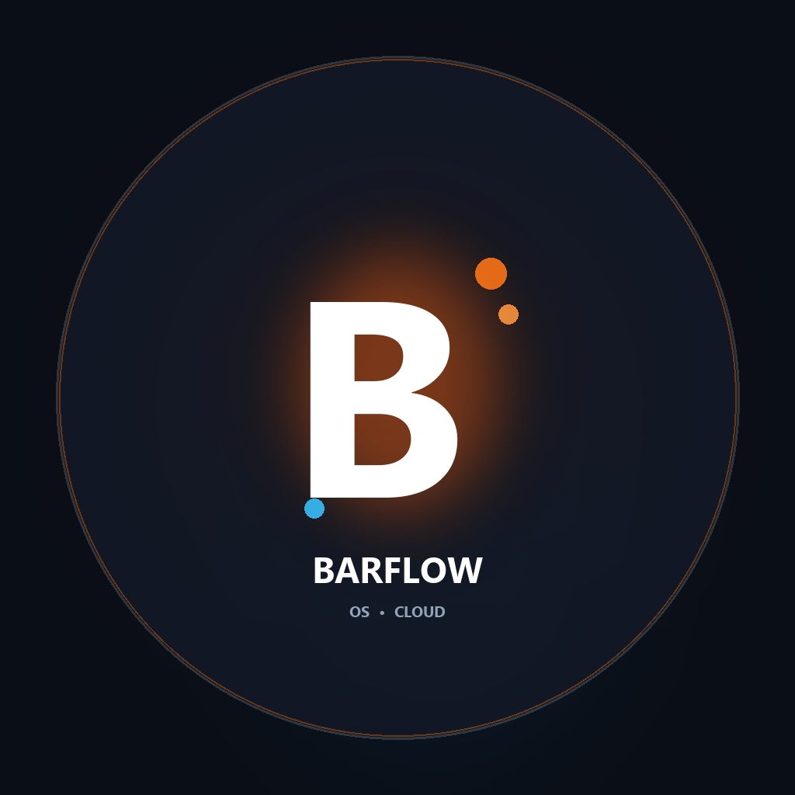
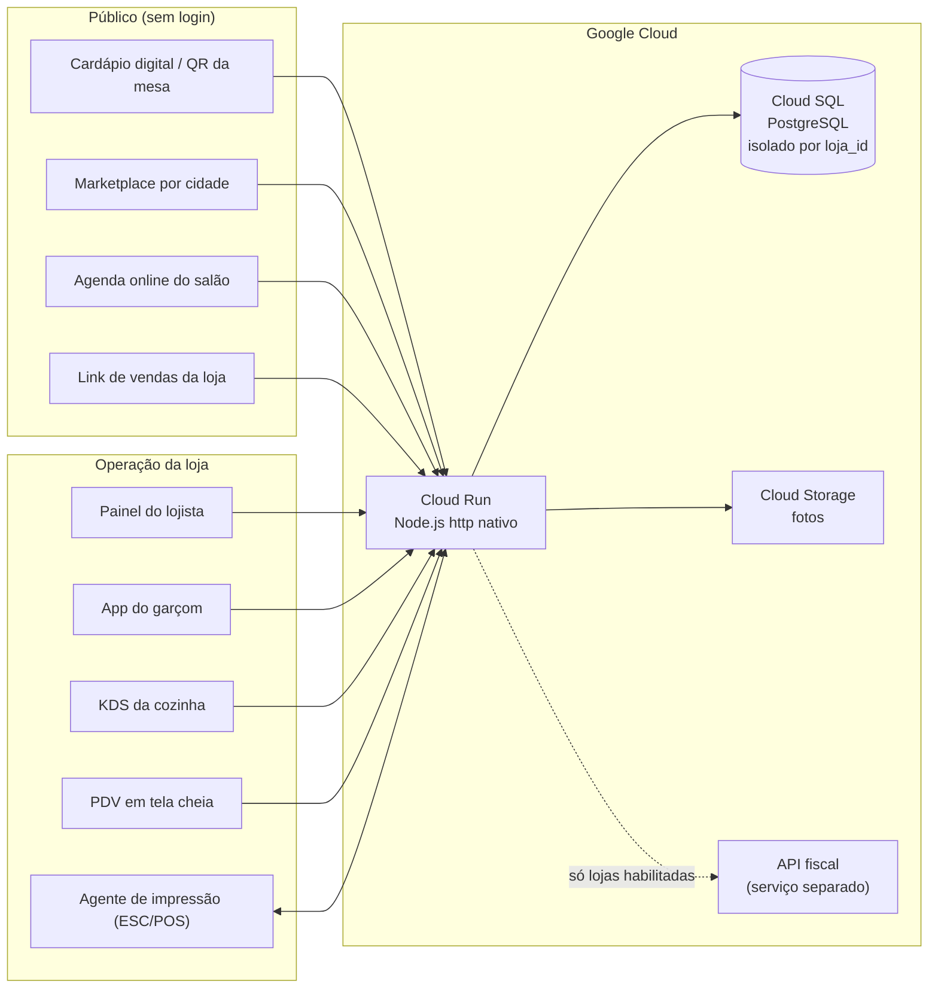

# BarFlow Cloud

**Plataforma SaaS multi-tenant de gestão para pequenos negócios: bar e restaurante, salão e barbearia, loja de varejo.**

[-brightgreen?style=flat-square)](#números-verificáveis)

> [!NOTE]
> **Sobre este repositório:** é uma **vitrine técnica curada** — descrição do produto, decisões de arquitetura e trechos de código representativos. O código-fonte completo é privado porque atende lojas reais em produção. Nenhum dado de cliente aparece aqui.

---

## Visão geral do ecossistema

Começou em agosto de 2026 como um sistema de bar construído em poucos dias para um primeiro cliente pagante. Desde então virou uma plataforma com **três frentes de produto sobre o mesmo núcleo**: um servidor Node.js, um banco PostgreSQL e isolamento por loja (`loja_id`) em toda consulta.

| Frente | Para quem | O que resolve |
|---|---|---|
| **[BarFlow](docs/barflow.md)** | Bar, restaurante, lanchonete, hamburgueria, pizzaria, açaiteria, confeitaria | Cardápio digital e QR de mesa, comanda do garçom, cozinha (KDS), caixa, estoque com ficha técnica, gestão financeira. Inclui o **ConfeiteiraFlow** (confeitaria por encomenda) e o marketplace **Tô com Fome** |
| **[BeautyFlow](docs/beautyflow.md)** | Salão de beleza, barbearia, manicure | Agenda online em que o cliente marca sozinho, painel do dia e financeiro do salão |
| **[FlowPDV](docs/flowpdv.md)** | Loja de varejo e loja de celular | Frente de caixa (PDV), produtos com variação e código de barras, estoque com custo médio, relatórios, gestão (DRE/CMV/curva ABC) e emissão fiscal **em homologação** |

Cada frente abre no próprio endereço, com marca e telas próprias, mas compartilha autenticação, permissões, motor de relatórios e gestão, impressão, push e a infraestrutura.

---

## BarFlow — bar, restaurante e confeitaria

Resumo (detalhes em [docs/barflow.md](docs/barflow.md)):

- **Cardápio digital público** com QR por mesa, fotos, adicionais com limite por tamanho, pizza meio a meio (cobra pelo sabor mais caro), promoções (de/por, combo, brinde, agendamento), horário de funcionamento por dia e pausa de item.
- **Comanda e mesas:** app do garçom no celular, mapa de mesas, pagamento parcial, transferência e junção de contas, taxa de serviço, proteção contra toque duplo. Totens de autoatendimento ativados por código de uso único.
- **KDS (cozinha):** fila em tempo real com cronômetro por pedido e alerta de atraso; bebidas que não passam pela cozinha ficam fora da tela.
- **Caixa:** abertura com troco, sangria e suprimento com autor, fechamento com conferência, relatório Z, desconto de balcão, correção de forma de pagamento — com "dia operacional" calculado no servidor para bar que fecha de madrugada.
- **Estoque com ficha técnica:** baixa automática a cada venda e estorno no cancelamento, custo PEPS, porções/fatias, entrada por XML de NF-e de compra e leitura de cupom por foto com IA de visão.
- **Gestão (BI):** DRE gerencial, CMV, margem de contribuição, ponto de equilíbrio, custos fixos × variáveis, previsão do mês, curva ABC, mapa de calor dia × hora, reajuste de preço sugerido e relatório A4.
- **Financeiro:** agenda de despesas com contas recorrentes, vale de funcionário, fornecedores, CSV para o contador.
- **Entrega:** taxa por bairro, cadastro de entregadores e acerto no fechamento.
- **ConfeiteiraFlow:** encomendas com data de entrega, sinal e acompanhamento pelo cliente; caixa rápido para feiras; receitas com custo por fatia.
- **Tô com Fome:** vitrine pública por cidade reunindo as lojas da plataforma, com cupons (primeiro pedido, frete grátis, cliente que volta). Sem comissão e sem intermediar pagamento: o pedido cai direto no painel da loja.
- **Assistente de suporte:** responde dúvidas do lojista a partir dos manuais oficiais (busca BM25 + resumo opcional por LLM, com checagem contra alucinação). A parte de IA é ligada por configuração.

## BeautyFlow — salão e barbearia

Resumo (detalhes em [docs/beautyflow.md](docs/beautyflow.md)):

- **Agenda pública:** o cliente escolhe serviço, profissional (ou "qualquer um"), dia e horário livre; depois confirma pelo WhatsApp, adiciona ao Google Agenda ou cancela por link próprio.
- **Sem horário duplicado:** trava por loja dentro da transação + constraint de exclusão no banco ([trecho](excerpts/agendamentoSemConflito.js)).
- **Painel do dia:** concluído / faltou / cancelar, encaixe de quem chegou na hora, horários da semana, serviços com foto.
- **Financeiro do salão:** faturamento, ticket médio, taxa de falta e ranking de serviços.
- Sinal via Pix é **informativo** (gera o copia-e-cola; não há gateway confirmando pagamento). Comissão e lembrete automático ainda não existem.

## FlowPDV — loja de varejo

Resumo (detalhes em [docs/flowpdv.md](docs/flowpdv.md)):

- **PDV em tela cheia** com atalhos F1–F12, leitor de código de barras, venda dividida em várias formas (dinheiro, Pix, débito, crédito à vista e parcelado, a prazo), orçamento que vira venda, CPF na nota, vendedor.
- **Produtos** com variações (preço e estoque próprios), código de barras único por loja, SKU, venda fracionada (kg, m, L), markup a partir do custo, etiquetas de gôndola EAN-13, importação por planilha .xlsx/.csv.
- **Estoque** com kardex (motivo e autor de cada movimento) e custo médio ponderado; entrada pelo XML da nota de compra.
- **Fiado, comissão de vendedor, devoluções, encomendas, financeiro e relatório do contador.**
- **12 relatórios** (curva ABC, produtos parados, margem baixa, estoque e reposição, horário de pico…) com exportação CSV.
- **Gestão:** DRE gerencial, CMV pelo custo médio, margem de contribuição e três pontos de equilíbrio — o mesmo motor de BI do BarFlow.
- **Importação de histórico de vendas de outro PDV** (CSV), com prévia antes de gravar, em tabelas próprias que nunca viram venda, caixa ou estoque — recém-concluída.
- **Fiscal (NFC-e modelo 65 e NF-e modelo 55):** implementado, **em homologação** e ligado loja a loja. Detalhes e limites em [docs/flowpdv.md](docs/flowpdv.md#fiscal).

---

## Arquitetura

Detalhes em [docs/arquitetura.md](docs/arquitetura.md).

| Decisão | Como é feito | Por quê |
|---|---|---|
| **Servidor** | Node.js com o módulo `http` nativo, sem Express | Menos dependências, imagem pequena, inicialização rápida no Cloud Run. São 4 dependências de produção |
| **Banco** | PostgreSQL (`pg`) com SQL escrito à mão | Dinheiro e estoque precisam de transação, trava de linha e constraint de verdade |
| **Multi-tenant** | Banco único, `loja_id` em toda tabela e toda consulta | Testes de ataque fazem login na loja A e tentam ler/alterar dados da loja B ([trecho](excerpts/multiTenantIsolation.test.js)) |
| **Concorrência** | `SELECT ... FOR UPDATE` na linha da loja dentro da transação | Serializa operações sensíveis por loja (agenda, caixa, mesa) sem travar as outras lojas |
| **Migrations** | Arquivos SQL idempotentes que rodam a cada boot, com ledger | Deploy sem passo manual; a revisão anterior continua subindo sobre o mesmo banco, o que mantém o rollback simples |
| **Invariantes** | Consultas somente leitura que conferem o estado acumulado (ex.: total da conta = soma das linhas) | Teste prova o código; invariante prova o dado ([trecho](excerpts/invariantesConta.js)) |
| **Auditoria no commit** | Hook de pre-commit roda um verificador estático (~1 s) e barra o commit se achar algo grave | Grave = vazar dado entre lojas, cobrar errado ou derrubar a operação |
| **Testes** | `node:test` contra PostgreSQL real descartável; telas testadas com jsdom montando a página de verdade | Sem mock de banco: o que passa no teste passa no Postgres |
| **Fiscal** | Serviço separado que monta, assina e transmite o XML; o sistema principal só envia o retrato da venda | O certificado do cliente não é guardado nem logado pelo sistema principal |
| **Hospedagem** | Google Cloud Run + Cloud SQL + Cloud Storage | Tudo roda na nuvem; a única peça instalada na loja é o agente de impressão, opcional |

---

## Números verificáveis

Contados no repositório privado em 11/11/2026:

| Item | Quantidade |
|---|---|
| Migrations SQL (idempotentes, numeradas até 332) | **268** arquivos |
| Arquivos de teste (`tests/*.test.js`) | **728** |
| Casos de teste (`test(...)` / `it(...)`) | **~4.350** |
| Deploys com registro escrito (data, revisão, plano de volta) | **mais de 260** |
| Commits | **~1.800** |
| Dependências de produção | **4** (`pg`, `@google-cloud/storage`, `fast-xml-parser`, `qrcode`) |

---

## Desafios de engenharia

1. **Isolamento multi-tenant testado com ataque.** Um teste adversarial loga como a loja A e tenta ler, editar, apagar e mudar status de registros da loja B. → [`excerpts/multiTenantIsolation.test.js`](excerpts/multiTenantIsolation.test.js)
2. **"Dia operacional" de bar.** Bar fecha às 4h; o servidor roda em UTC e a loja em UTC-3. A data contábil é calculada só no servidor, com hora de corte por loja. → [`excerpts/caixaService.js`](excerpts/caixaService.js)
3. **Rate limit vs. Wi-Fi compartilhado.** Clientes e funcionários saem pelo mesmo IP do bar; limitadores separados por rota evitam que o cardápio público bloqueie o login do dono. → [`excerpts/rateLimit.js`](excerpts/rateLimit.js)
4. **Dois clientes, mesmo horário.** Agendamento serializado por loja, pedido repetido por sinal fraco reconhecido e constraint de exclusão como rede final. → [`excerpts/agendamentoSemConflito.js`](excerpts/agendamentoSemConflito.js)
5. **Dinheiro que não fecha sem dar erro.** Dez invariantes de conta, cada uma nascida de um defeito real (pagamentos parciais simultâneos, pedido cancelado que "ressuscita", conta aberta em mesa livre), conferidas em modo somente leitura. → [`excerpts/invariantesConta.js`](excerpts/invariantesConta.js)
6. **`ON CONFLICT DO NOTHING` sem constraint.** Sem `UNIQUE` correspondente, a cláusula não faz nada e o seed duplicava a cada deploy. Corrigido com deduplicação transacional e criação da constraint.
7. **Histórico de outro sistema sem contaminar o caixa.** A importação grava em tabelas próprias, substitui em vez de duplicar ao reimportar e só aparece na Gestão e nos relatórios quando o lojista pede.

---

## Stack

- **Backend:** Node.js (`http` nativo), PostgreSQL via `pg`, SQL puro
- **Frontend:** HTML/CSS/JavaScript sem framework, mobile-first, PWA no cardápio
- **Infra:** Google Cloud Run, Cloud SQL, Cloud Storage, Secret Manager, Docker
- **IA:** Gemini (visão para leitura de cupom de compra; resumo no assistente de suporte), ligada por configuração
- **Integrações:** Web Push sem biblioteca, impressão térmica ESC/POS por agente local, WhatsApp (links e webhook da API oficial), login Google para clientes
- **Qualidade:** `node:test`, jsdom, hooks de pre-commit e pre-push, registro de deploys com plano de volta

---

## Autor

**Idarlan Magalhães** — desenvolvedor de software (IA, automação e arquitetura web)

[GitHub](https://github.com/idarlandias) · [LinkedIn](https://www.linkedin.com/in/idarlandias/)
