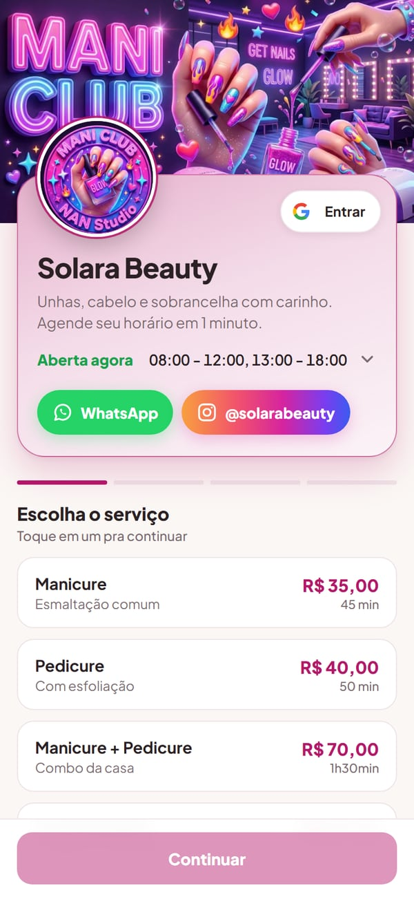
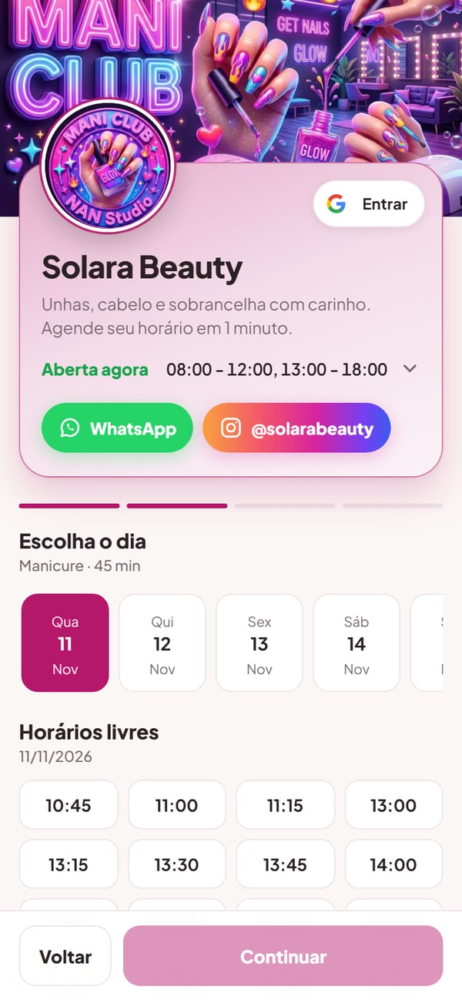
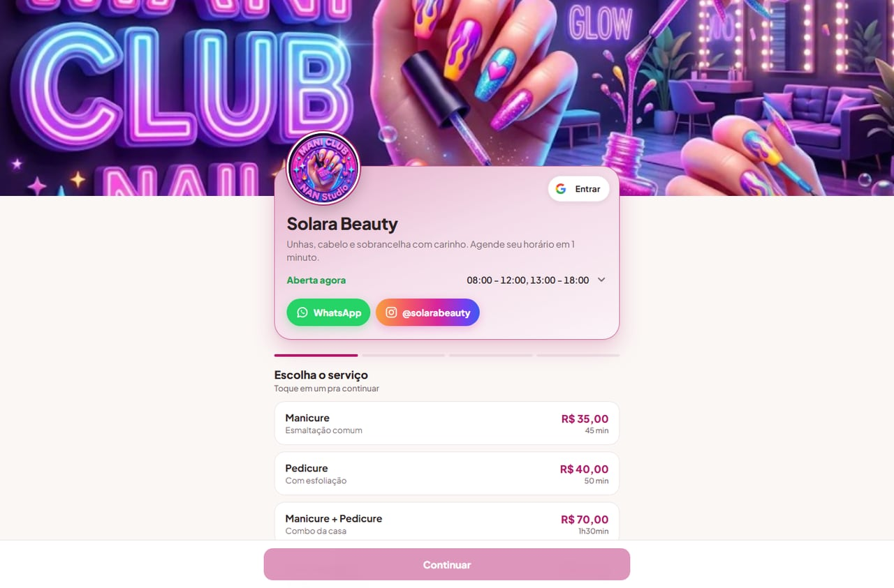
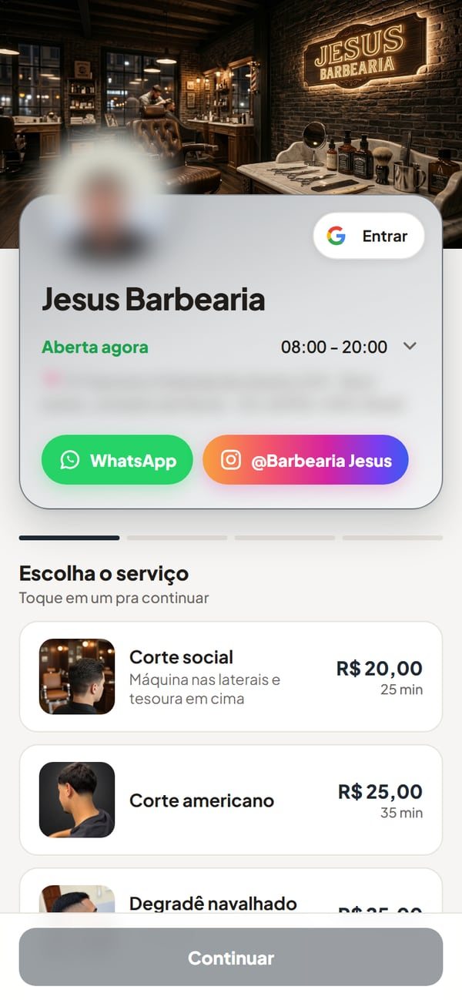
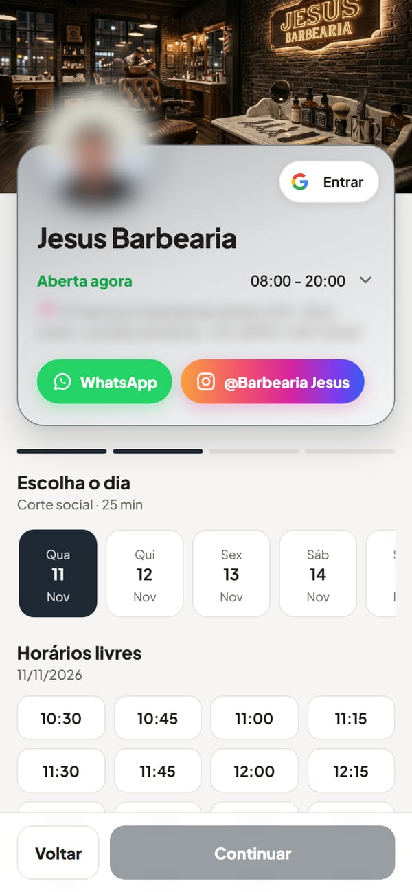
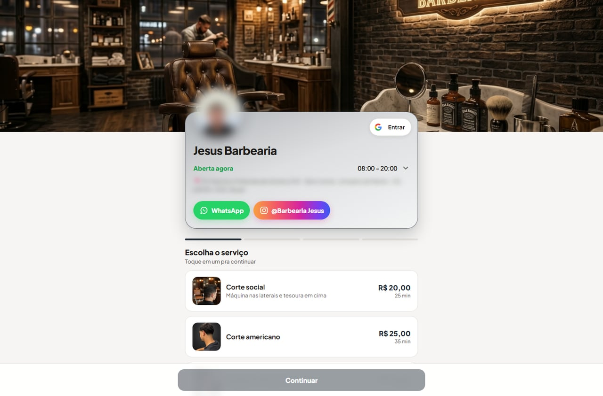
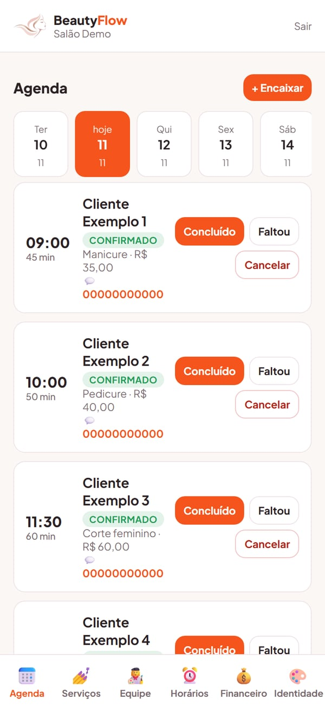
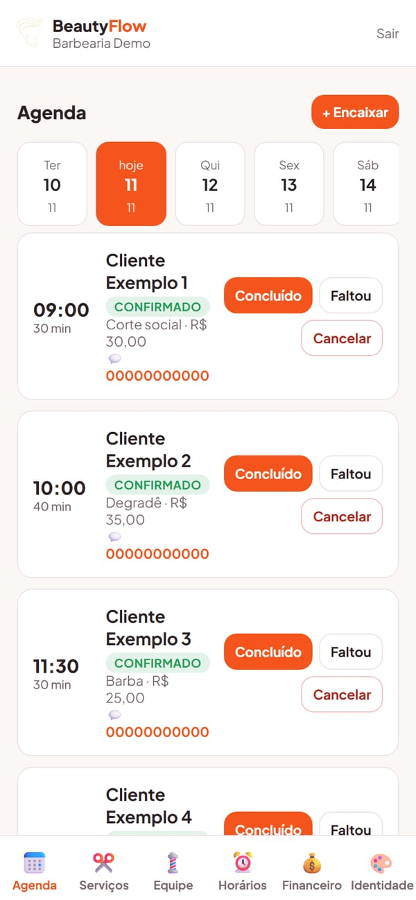
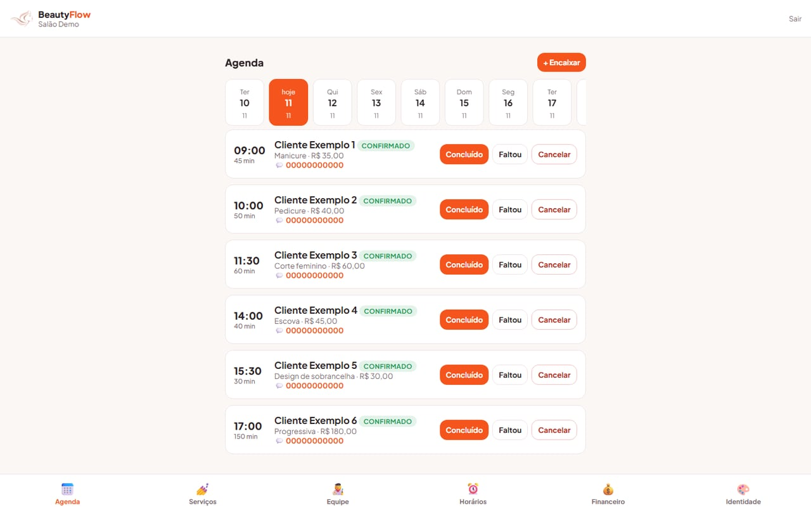

# BeautyFlow — salão de beleza e barbearia

> **In English:** BeautyFlow is the salon and barbershop product of Flow Ecosystem: a public booking page where clients pick a service, day and free time slot on their own, conflict-free scheduling enforced in the database, a daily agenda for the staff and salon financials. Screenshots below show live booking pages and the back office with demo data.

Agenda online do Flow Ecossistema, no mesmo núcleo do BarFlow e do FlowPDV: a loja é do tipo salão, com marca, cores e fotos próprias. Plano de referência no código: R$ 59,90/mês.

## Telas

As telas públicas são de lojas reais em produção, com autorização do dono (nome, logo, cardápio e preços públicos); telefone, endereço e foto de pessoa aparecem desfocados. As telas internas exigem login e foram tiradas de lojas de demonstração num servidor local, com **dados de demonstração** (nomes como "Sushi Demo" e "Cliente Exemplo" são fictícios).

### Públicas — agenda online de um salão e de uma barbearia (lojas reais)

| Salão — escolha do serviço | Salão — escolha do dia e do horário livre | Salão — agenda no computador |
|---|---|---|
|  |  |  |

| Barbearia — escolha do serviço | Barbearia — escolha do dia e do horário livre | Barbearia — agenda no computador |
|---|---|---|
|  |  |  |

### Internas — "Salão Demo" e "Barbearia Demo" (dados de demonstração)

| Painel do dia do salão (celular) | Painel do dia da barbearia (celular) | Painel do dia do salão (computador) |
|---|---|---|
|  |  |  |

## Agenda pública (cliente)

- Página pública do salão: o cliente escolhe o serviço, o profissional (ou "qualquer profissional"), o dia (janela de 14 dias) e um horário livre, e informa nome e WhatsApp. Não precisa de conta.
- Login Google opcional para preencher os dados e ver "Meu perfil".
- Depois de reservar: confirmar pelo WhatsApp do salão, adicionar ao Google Agenda e cancelar por link com token próprio.
- Regras: respeita pausa, bloqueios e antecedência mínima; limite de reservas por IP e por telefone; o texto digitado passa pelo sanitizador antes de aparecer no painel.

## Sem horário duplicado

Dois clientes tocando no mesmo horário ao mesmo tempo:

1. A transação trava a linha da loja (`SELECT ... FOR UPDATE`): o segundo espera e já enxerga o horário ocupado.
2. Quem não escolheu profissional cai no primeiro da equipe que está livre, em vez de ouvir "ocupado".
3. Pedido repetido (resposta perdida em sinal fraco e segundo toque) devolve o agendamento já gravado.
4. Constraint de exclusão no banco como rede final; o erro vira HTTP 409 com mensagem amigável.

Trecho: [`excerpts/agendamentoSemConflito.js`](../excerpts/agendamentoSemConflito.js).

## Painel do salão

- Agenda do dia com concluído / faltou / cancelar, e **encaixe** de quem chegou na hora.
- Equipe de profissionais com cor e ordem; agenda por profissional.
- Serviços com duração, preço e foto (há um acervo de fotos de serviço para quem ainda não tem as próprias).
- Horários da semana e identidade visual do salão.
- Financeiro: faturamento, ticket médio, taxa de falta e ranking por serviço.

## Limites atuais

- **Sinal via Pix é informativo:** o sistema gera o código copia-e-cola com o valor, mas não há gateway nem confirmação automática de pagamento.
- Não há comissão por profissional nem lembrete automático por WhatsApp.
