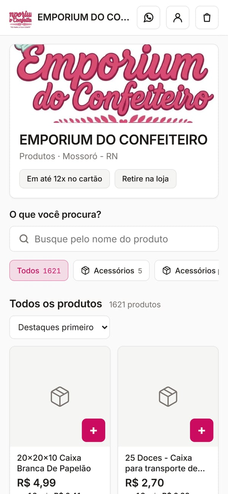
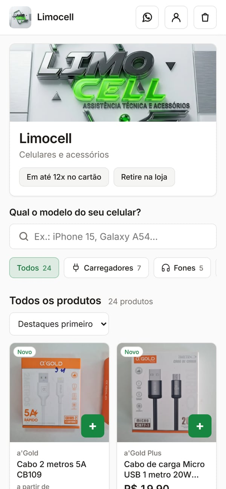
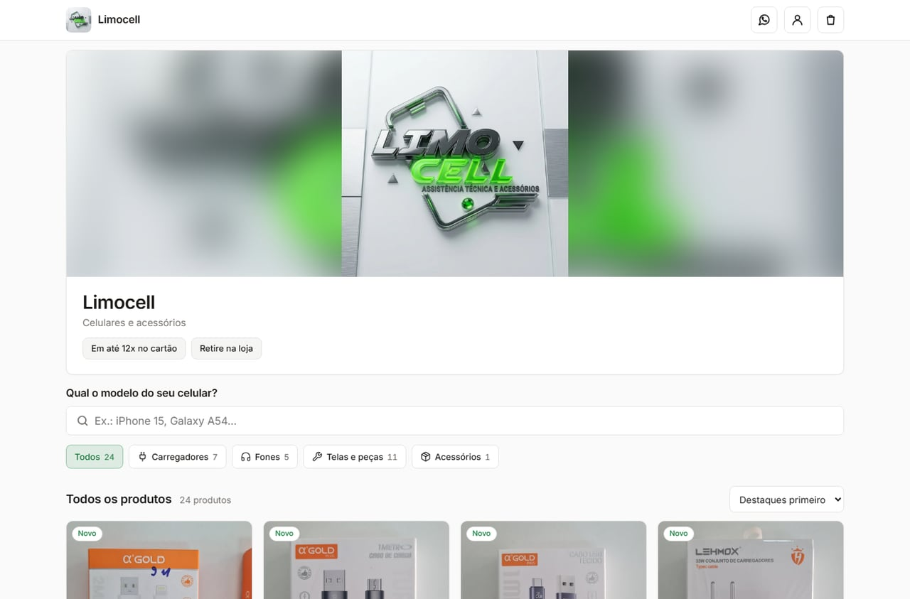
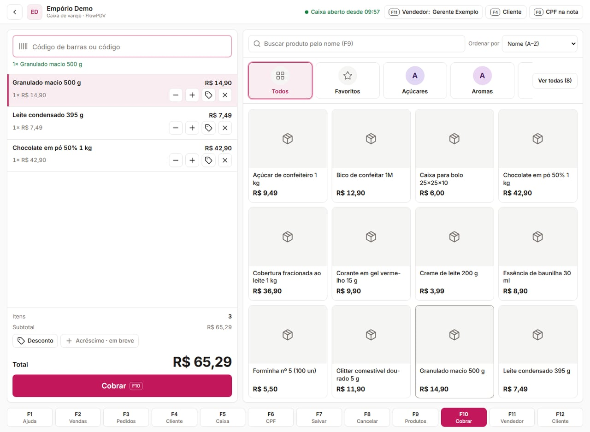
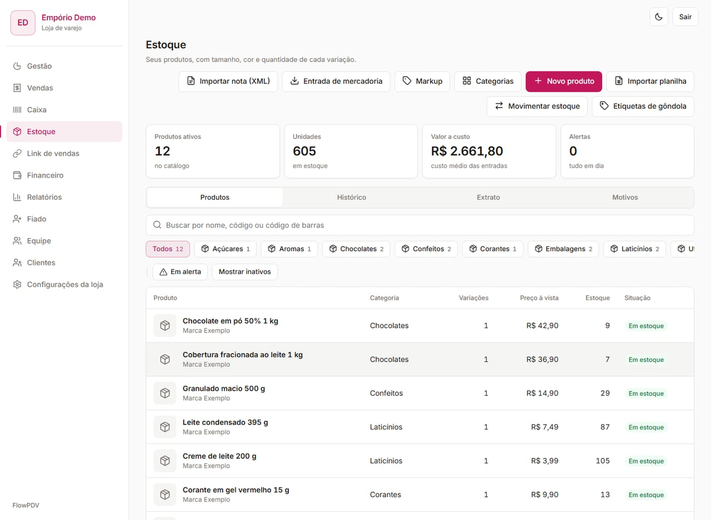
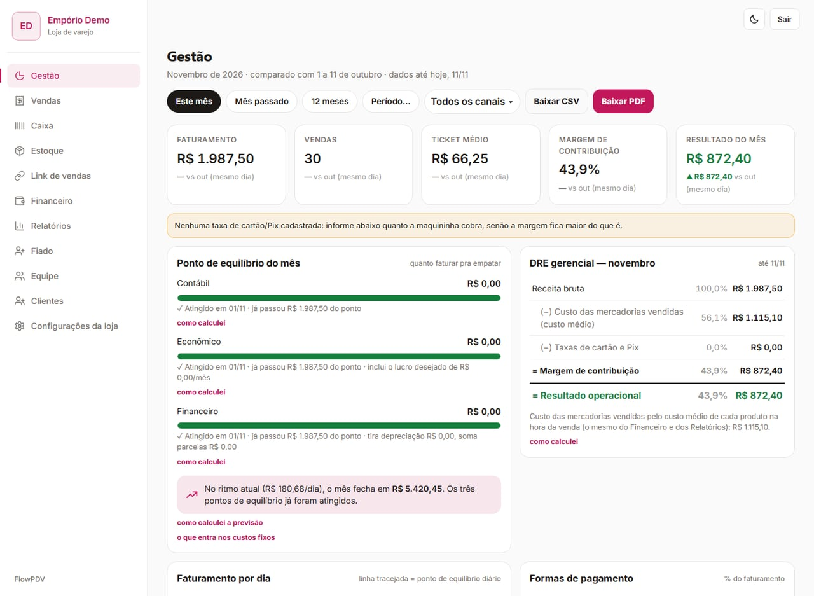
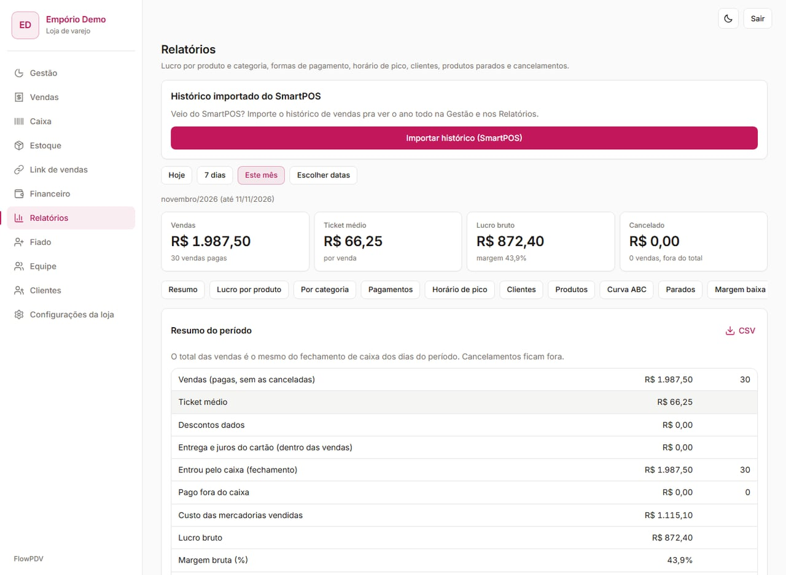

# FlowPDV — loja de varejo e loja de celular

> **In English:** FlowPDV is the retail product of Flow Ecosystem: a full-screen point of sale with barcode support, products with variants, weighted-average-cost inventory, 12 reports, a management dashboard (P&L, COGS, break-even) and an online storefront. Brazilian e-invoicing (NFC-e and NF-e) is implemented and in certification with state tax authorities. Screenshots below show live storefronts and the back office with demo data.

Frente de caixa e retaguarda para varejo, sobre o mesmo núcleo multi-tenant do Flow Ecossistema. Abre em endereço próprio e é habilitada por configuração. É a frente mais nova: está em implantação com as primeiras lojas, e parte dos módulos abaixo foi concluída nas últimas semanas. Plano de referência no código: R$ 99,90/mês.

## Telas

As telas públicas são de lojas reais em produção, com autorização do dono (nome, logo, cardápio e preços públicos); telefone, endereço e foto de pessoa aparecem desfocados. As telas internas exigem login e foram tiradas de lojas de demonstração num servidor local, com **dados de demonstração** (nomes como "Sushi Demo" e "Cliente Exemplo" são fictícios).

### Públicas — vitrines de lojas reais

| Emporium do Confeiteiro (varejo de confeitaria) — celular | Limocell (celulares e acessórios) — celular |
|---|---|
|  |  |

| Emporium do Confeiteiro — computador | Limocell — computador |
|---|---|
|  |  |

### Internas — loja de demonstração "Empório Demo" (dados de demonstração)

| PDV em tela cheia com venda em andamento | Estoque com custo médio e código de barras |
|---|---|
|  |  |

| Gestão — DRE com CMV pelo custo médio | Relatórios — resumo do período e abas (curva ABC, margem, pico) |
|---|---|
|  |  |

## PDV (frente de caixa)

- Tela cheia com atalhos F1–F12, pensada para teclado e leitor de código de barras (USB ou bluetooth).
- Pagamento em dinheiro, Pix, débito, crédito à vista e parcelado, a prazo (fiado) e venda dividida em várias formas.
- CPF na nota, vendedor da venda, desconto por item e por venda, comprovante pelo agente de impressão.
- Pedido em aberto e orçamento que vira venda (orçamento não aceita preço livre).

## Produtos

- Variações com preço e estoque próprios.
- Código de barras único por loja (EAN/UPC) e SKU.
- Categorias com foto e ordem; fotos de produto com validação do tipo do arquivo.
- Venda fracionada (kg, g, m, L) e preço livre quando permitido.
- Markup que calcula o preço de venda a partir do custo.
- Etiquetas de gôndola com EAN-13.
- Importação de produtos por planilha .xlsx ou .csv (leitor próprio, sem dependência nova).
- Para loja de celular: modelos compatíveis, condição do aparelho e preço parcelado calculado no servidor.

## Estoque

- Kardex: todo movimento tem motivo e autor.
- Custo médio ponderado calculado por uma única função no banco.
- Entrada de mercadoria pelo XML da NF-e de compra.

## Retaguarda

- Clientes e fornecedores com CPF/CNPJ validado (dígito verificador) no servidor.
- Fiado / contas a receber com limite e prazo.
- Comissão de vendedor.
- Devoluções de cliente e para fornecedor.
- Encomendas do que está em falta.
- Financeiro (despesas, contas fixas, CSV) e relatório para o contador.
- Link de vendas: vitrine pública da loja com carrinho enviado pelo WhatsApp, acompanhamento do pedido e "meus pedidos".

## Relatórios

Doze relatórios com período de até 366 dias e exportação CSV: resumo, lucro por produto, lucro por categoria, formas de pagamento, horário de pico, ranking de clientes, ranking de produtos, curva ABC, produtos parados, margem baixa, estoque (posição e reposição), cancelamentos e devoluções.

## Gestão

Usa o mesmo motor de BI do BarFlow, alimentado pelas vendas do varejo:

- DRE gerencial.
- CMV pelo custo médio no momento da venda.
- Margem de contribuição.
- Ponto de equilíbrio contábil, econômico e financeiro.
- Curva ABC e ticket médio.

## Importação de histórico de outro PDV

Para a loja que está trocando de sistema não começar "do zero" nos relatórios:

- Até 4 arquivos CSV (separador `;`), com o tipo detectado pelo cabeçalho: vendas por dia, por categoria e por produto. O produto é casado pelo código de barras ou SKU.
- Prévia antes de gravar; reimportar substitui em vez de duplicar.
- Grava em tabelas próprias: **nunca vira venda, caixa ou estoque**. Entra na Gestão e na opção "somar o histórico" dos relatórios.

Recém-concluída no código.

## Fiscal

**Estado: implementado, em homologação junto à SEFAZ, ligado loja a loja.** Nenhuma loja emite nota por padrão.

- **Arquitetura:** a emissão fica num serviço separado (API fiscal), que monta o XML, assina e conversa com a SEFAZ. O sistema principal só envia o retrato da venda, autenticado por chave. Sem essa API configurada, rotas e telas fiscais não aparecem.
- **Certificado A1** (.pfx/.p12) enviado direto para a API fiscal; o sistema principal não guarda nem loga o arquivo. O ambiente de produção não pode ser ligado pela tela; valor desconhecido cai em homologação.
- **NFC-e (modelo 65):** emissão manual ou automática após a venda (idempotente pela venda), cancelamento, contingência com transmissão posterior, DANFE pela impressora ou navegador, telas de notas pendentes e notas a cancelar.
- **NF-e (modelo 55):** venda para CNPJ, com trava de uma nota por venda; cancelamento, carta de correção, DANFE A4 e NF-e de devolução.
- **Multi-estado:** validação de Inscrição Estadual para as 27 UFs. A homologação começou por um estado; os demais dependem de configuração e teste em cada SEFAZ.
- **Em desenvolvimento:** tela de inutilização de numeração.
